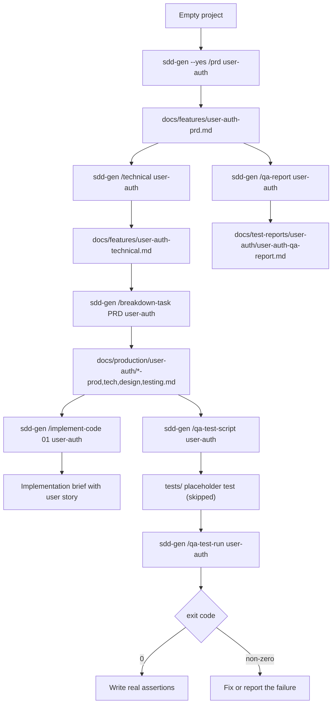
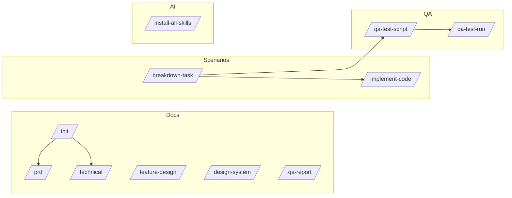

# PRD — sdd-dev-cli

## 1. Problem

Teams that use AI coding agents still hand-write the same documents for every
feature: PRD, technical design, scenario breakdown, test specification, QA
report. The output drifts between people, the AI tool has no shared file
layout to read from, and none of it is repeatable.

`sdd-dev-cli` gives one command set that scaffolds that document chain in a
predictable place, plus skills and workflow files that the AI tool reads so its
answers stay anchored to the same documents.

## 2. Target users

| User | Need |
| --- | --- |
| Backend/frontend developer using an AI agent | Generate the document chain for one feature without inventing a layout |
| Tech lead / reviewer | Consistent file names and sections across features and teammates |
| QA engineer | Scenario-level test specifications that map to source documents |

## 3. Goals

- One command per document type, named by feature slug.
- Deterministic output paths so tools and humans find files without asking.
- Safe by default: no writes outside the project, no silent overwrite.
- Non-interactive mode (`--yes`) for scripts and CI.
- Generate test scaffolding for the project's existing test framework.
- Keep the tool dependency-light: Node.js only, no service, no database.

## 4. Non-goals

- Replacing the AI agent that writes document content.
- Editing application code or running a full test suite for the user.
- Hosting documents or syncing them across machines.
- Enforcing a specific methodology beyond the file layout.

## 5. Command inventory

Verified against `index.js` registrations.

| Command | Arguments | Output |
| --- | --- | --- |
| `/prd` | `[featureName]` | `docs/features/<feature>-prd.md` |
| `/technical` | `[featureName]` | `docs/features/<feature>-technical.md` |
| `/feature-design` | `[featureName]` | `docs/features/<feature>-design.md` |
| `/design-system` | — | `docs/DESIGN.md` |
| `/breakdown-task` | `<prdFile> [featureName]` | `docs/production/<feature>/<feature>-<nn>-<slug>-{prod,tech,design,testing}.md` |
| `/implement-code` | `<scenarioNumber> [featureName]` | `docs/production/<feature>/<feature>-<nn>-<slug>-implement.md` |
| `/qa-test-script` | `[featureName]` | a test file under `tests/` for the chosen framework |
| `/qa-test-run` | `[featureName]` | runs the generated test command, propagates its exit code |
| `/qa-report` | `[featureName]` | `docs/test-reports/<feature>/<feature>-qa-report.md` |
| `/init` | `<featureName>` | PRD, technical, spec test, and QA report in one pass |
| `/install-all-skills` | — | skills, workflows, and templates copied into selected AI tool folders |

Global flags: `--yes` (non-interactive), `--force` (overwrite generated files),
`--version`, `--help`.

Aliases: `/sdd-breakdown-task`, `/sdd-implement-code`.

## 6. Safety promises

- Feature names must be a single slug; path separators and traversal are rejected.
- Every generated path is checked to stay inside its output directory.
- Existing generated files are preserved unless `--force` is given.
- Project test commands run without a shell string (`shell: false`); the Windows
  `mvn` `.cmd` shim is the documented `cmd.exe` exception.
- Generated tests are skipped placeholders until a human writes assertions.

## 7. Success criteria

- A new user can go from an empty project to a breakdown file set using only
  documented commands.
- Repeating a command never destroys an edited document without `--force`.
- `npm test` and `npm run uat` pass before a release, with counts recorded in
  `docs/test-report/test-report.md` and `docs/test-report/uat-report.md`.

## 8. Out of scope for 1.x

- Framework-specific assertion generation from acceptance criteria.
- Multi-repository or monorepo-aware output layouts.
- A plugin API for custom document types.
- Any hosted service, account system, or network API — the CLI makes no network
  calls except the Playwright dependency install it triggers on demand.

## 10. End-to-end flow

The generated test is a **skipped placeholder** on purpose: the tool never
claims feature coverage it did not verify.

## 11. Command groups

