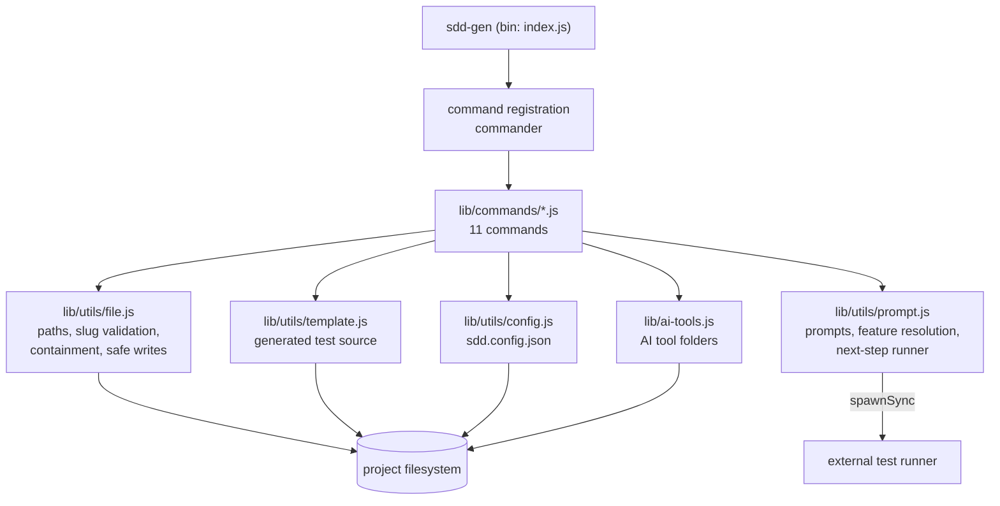
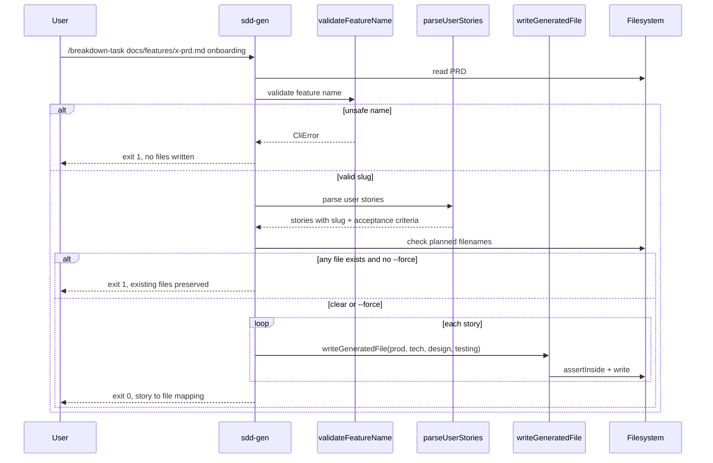
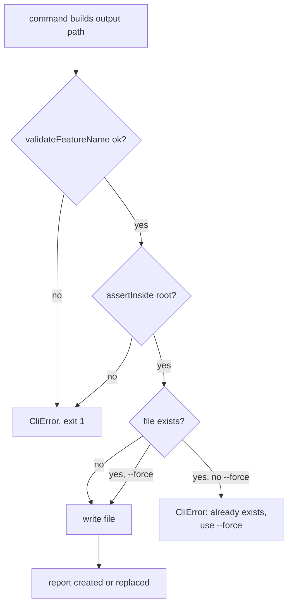
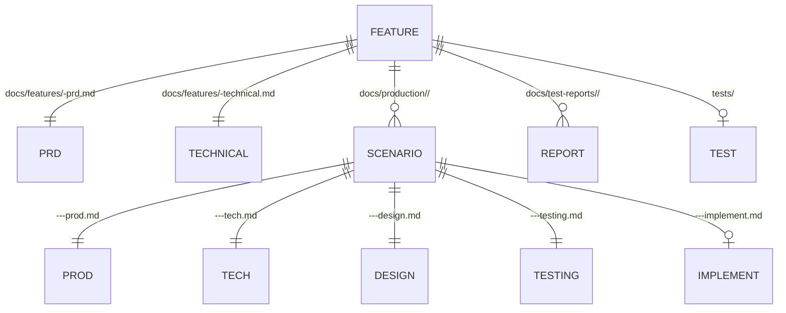
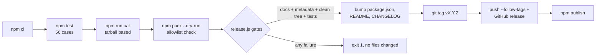

# Technical Design — sdd-dev-cli

Scope and motivation live in `docs/prd.md`. This document describes how the CLI
is built today, with the files that implement each part.

## 1. Runtime shape

```text
sdd-gen (bin)  ->  index.js
                     | registers 11 commands via commander
                     v
                 lib/commands/<name>.js   one file per command
                     |
                     +--> lib/utils/file.js      paths, validation, writes
                     +--> lib/utils/prompt.js    prompts, next steps
                     +--> lib/utils/config.js    sdd.config.json
                     +--> lib/utils/template.js  generated test source
                     +--> lib/utils/version.js   version lookup
                     +--> lib/ai-tools.js        AI tool folders
```

`index.js` holds only wiring: version flag, global options (`--yes`,
`--force`), command registration, and help output when no command is given.

## 2. File layout written into a project

| Path | Owner command |
| --- | --- |
| `docs/features/<feature>-prd.md` | `/prd`, `/init` |
| `docs/features/<feature>-technical.md` | `/technical`, `/init` |
| `docs/features/<feature>-design.md` | `/feature-design` |
| `docs/DESIGN.md`, `docs/README.md` | `/design-system`, directory bootstrap |
| `docs/production/<feature>/<feature>-<nn>-<slug>-{prod,tech,design,testing}.md` | `/breakdown-task` |
| `docs/production/<feature>/<feature>-<nn>-<slug>-implement.md` | `/implement-code` |
| `docs/test-reports/<feature>/<feature>-{spec-test,qa-report}.md` | `/init`, `/qa-report` |
| `tests/…` | `/qa-test-script` |
| `sdd.config.json` | every command that resolves a feature or framework |
| `.devin/ .opencode/ .claude/ .antigravity/ .hermes/` | `/install-all-skills` |

Paths are derived in `lib/utils/file.js` (`getPaths`), relative to
`process.cwd()`. `SDD_CLI_ROOT` overrides the CLI root so tests and the UAT
runner can point at an extracted tarball.

## 3. Generation pipeline

1. Command resolves the feature name: explicit argument, then
   `sdd.config.json` `lastFeature`, then the only `docs/features/*-prd.md`.
2. Name is validated (`validateFeatureName`) before any side effect.
3. Templates are read from `<cli>/templates/*.md`; placeholders
   (`<Feature>`, `<StoryId>`, `[Feature Name]`, `[YYYY-MM-DD]`, ...) are filled
   by `fillDocTemplate` / per-command replacements.
4. Output is written through `writeGeneratedFile`, which resolves the path,
   asserts it stays inside the target directory (`assertInside`), and refuses
   to replace an existing file unless `--force` was passed.
5. `/breakdown-task` pre-checks all planned scenario files first, so a refused
   run writes nothing instead of a partial breakdown.

## 4. Safety model

| Risk | Control | Location |
| --- | --- | --- |
| Path traversal via feature name | slug regex `^[A-Za-z0-9][A-Za-z0-9_-]*$` | `lib/utils/file.js` |
| Write outside output root | `assertInside` compares resolved paths | `lib/utils/file.js` |
| Silent overwrite | `writeGeneratedFile` refuses existing files | `lib/utils/file.js` |
| Command injection | `spawnSync` with argument arrays, no shell | `lib/commands/qa-test-run.js`, `lib/utils/prompt.js` |
| Injected code in generated tests | specification emitted as line comments, identifiers sanitised | `lib/utils/template.js` |
| False-green tests | placeholders emitted as skip/disable markers | `lib/utils/template.js` |
| Unknown framework config | validated before directories or config writes | `lib/commands/qa-test-script.js` |
| Partial documentation | templates validated before any write | `lib/commands/init.js` |

Windows detail: `npx`/`npm` are `.cmd` shims. The runner resolves npm's JS
entry point and spawns it with `node`; other `.cmd` shims (`mvn`) fall back to
`cmd.exe` with every argument quoted. This is the only place a shell-like
parent is used, and it never receives an unquoted user value.

## 5. Test generation per framework

`FRAMEWORKS` in `lib/commands/qa-test-script.js` maps to file conventions:

| Framework | File | Placeholder marker |
| --- | --- | --- |
| playwright | `tests/<feature>.spec.ts` | `test.skip(...)` |
| jest | `tests/<feature>.test.ts` | `test.skip(...)` |
| phpunit | `tests/Feature/<Feature>Test.php` | `markTestSkipped(...)` |
| xunit | `tests/<Feature>Tests.cs` | `[Fact(Skip = ...)]` |
| nunit | `tests/<Feature>Tests.cs` | `[Ignore(...)]` |
| junit | `tests/src/test/java/<Feature>Test.java` | `@Disabled(...)` |
| pytest | `tests/test_<feature>.py` | `pytest.skip(...)` |
| gotest | `tests/<feature>_test.go` | `t.Skip(...)` |

Specification text is never placed in executable syntax: each line becomes a
`//` comment (`#` for Python), and PHP's `?>` is neutralised inside comments.

## 6. Test and release tooling

| Concern | Implementation |
| --- | --- |
| Unit/integration tests | `node --test` over `tests/cli/*.test.js` (56 cases) |
| End-to-end command checks | `scripts/uat.js` packs the CLI and runs every command (`npm run uat`) |
| Release gate | `scripts/release.js` verifies required docs, metadata, clean tree, and `npm test` before touching files |
| CI | `.github/workflows/ci.yml` — `npm ci`, `npm test`, package inspection on Node 20/22/24 |
| Package contents | `files` allowlist in `package.json`; enforced by `tests/cli/package.test.js` and CI |

## 7. Configuration

`sdd.config.json` in the project directory stores `lastFeature`,
`testFramework`, and `projectType`. `lib/utils/config.js` whitelists those keys,
returns `{}` for missing or malformed files, and treats write failures as
warnings rather than crashes.

## 8. Known limits

- Generated tests contain no acceptance-criteria assertions; they are skipped
  placeholders by design.
- `/qa-test-run` needs the project's own registered test runner; the CLI does
  not install framework dependencies (Playwright is the exception, installed on
  demand).
- No lockfile-based determinism for the project being scaffolded; only the CLI's
  own dependencies are locked.
- `.gitignore` in this repository ignores `openspec/`, so planning artifacts stay
  local and are absent from normal commits.

## 9. Decision log

| Decision | Reason |
| --- | --- |
| Plain CommonJS, no build step | The tool runs from source; no dist artifact to keep in sync |
| Templates as Markdown files in the package | Users can inspect and override output by reading `templates/` |
| Validation in one helper instead of per command | A single contract cannot drift between commands |
| Skip markers instead of failing placeholders | A skipped test is visible in every framework without breaking a suite |
| Evidence documents in `docs/` | Reviewable in the same PR that prepares the release |

## 10. Diagrams

### 10.1 Module graph



### 10.2 `/breakdown-task` sequence



### 10.3 Write-safety decision



### 10.4 Document lineage (data model)

There is no database. The data model is a directory tree; relationships are
expressed by file names and by the feature slug shared across directories.



`<f>` is the feature slug, `<nn>` the two-digit scenario number, `<slug>` the
story slug derived from the PRD title (or `story-<n>` when the title is absent).

### 10.5 Release pipeline



## 11. Data model — files, not a database

The CLI stores no relational data and requires no service:

| Store | Contents | Lifecycle |
| --- | --- | --- |
| `docs/**` | Generated Markdown documents | User-owned after first write; never overwritten without `--force` |
| `tests/**` | Generated test scaffolding | Skipped placeholders until a human edits them |
| `sdd.config.json` | `lastFeature`, `testFramework`, `projectType` | Rewritten on each successful resolution; malformed file is ignored |
| AI tool folders | Copied skills, workflows, templates | Existing files kept unless `--force` |

There is no schema, migration, or transaction: every write is a single file
write after validation, and `/breakdown-task` pre-checks its whole plan so a
refusal leaves the directory untouched.

## 12. Interfaces — CLI only

No HTTP API, no account, no telemetry. The public interface is the command line:

```text
sdd-gen [--yes] [--force] [--version] [--help] <command> [arguments]
```

External processes invoked: the project's own test runner (`npx playwright`,
`npx jest`, `php artisan`, `dotnet`, `mvn`, `python -m pytest`, `go test`) and
`npm` for the on-demand Playwright install. All are started with argument
arrays; no shell string is built from user input.
